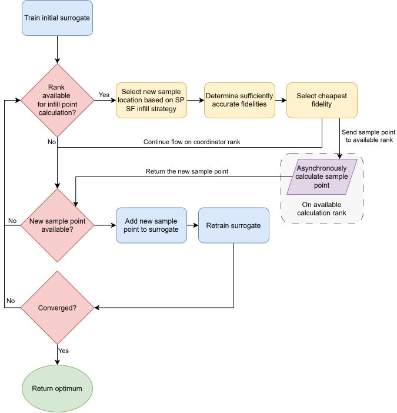
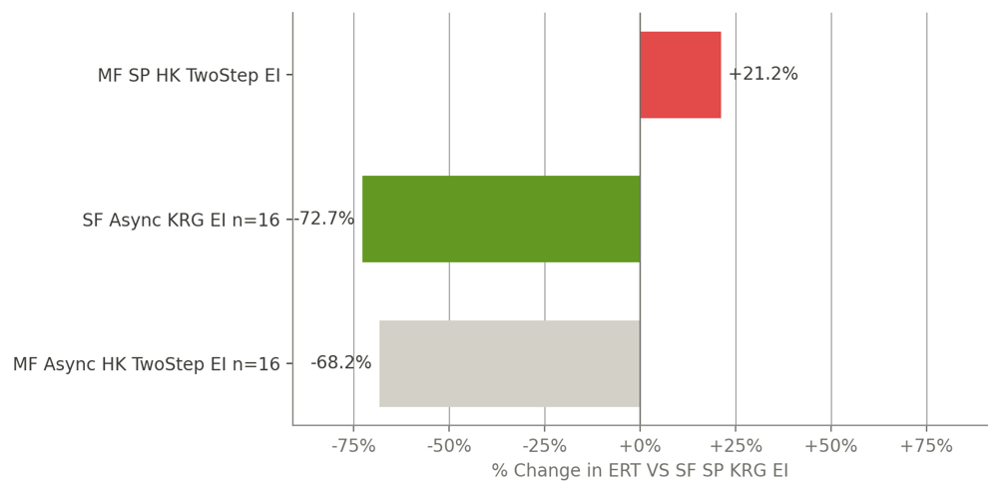

# Multi-fidelity Multi-point SBO

[](https://github.com/ioostmeijer/multi-fidelity-multi-point-sbo/actions/workflows/ci.yml)
[](https://ioostmeijer.github.io/multi-fidelity-multi-point-sbo/)

[](https://github.com/astral-sh/uv)
[](LICENSE)

A framework for surrogate-based optimisation (SBO) with asynchronous multi-point and/or multi-fidelity infill
strategies, developed for my MSc thesis
[*Combining an Asynchronous Multi-Point and a Multi-Fidelity Infill Strategy for Surrogate-Based Optimisation*](https://resolver.tudelft.nl/uuid:baf55719-5cc1-42ae-b9f7-55af0f2292d8)
(Delft University of Technology, 2026).

Version 1.0.0 is the code exactly as used for the thesis results. It is not actively developed: known limitations and
unfinished parts are listed under [Algorithms](#algorithms), and issues and pull requests may not get a response.

**Documentation:** <https://ioostmeijer.github.io/multi-fidelity-multi-point-sbo/>

## Features

- **Efficient Global Optimisation (EGO)** with Kriging, RBF and hierarchical Kriging surrogates and the Expected
    Improvement, Generalised Expected Improvement and two-step infill strategies.
- **Multi-point optimisation:** several points are evaluated in parallel with MPI, synchronously (`EgoMPI`) or
    asynchronously (`EgoAsync`).
- **Multi-fidelity optimisation:** cheap lower-fidelity function(s) can be combined with the expensive high-fidelity
    one.
- **Verified implementations**, checked against reference implementations.
- **HPC support** with an Apptainer container that uses the cluster's MPI.

The thesis combines asynchronous multi-point and multi-fidelity optimisation: the coordinator rank chooses a new sample
location with a single-fidelity infill strategy and then the cheapest fidelity that is accurate enough there
(`TwoStep`), and a free rank evaluates it asynchronously while the coordinator keeps adding the returned points to the
surrogate.



## Results

My thesis benchmarked the strategies on eleven two-fidelity test functions and compared them with sequential,
single-fidelity EGO (Kriging and Expected Improvement), using the expected runtime (ERT) to reach the optimum:

- **Asynchronous multi-point** (16 MPI processes: 1 coordinator and 15 workers): the ERT dropped by **72.7%**, a
    statistically significant improvement.
- **Multi-fidelity** (hierarchical Kriging with `TwoStep`, single-point): the ERT increased by 21.2%.
- **Both combined:** the ERT dropped by 68.2%, so the multi-fidelity part cost some of the multi-point gain.

The multi-fidelity strategy added redundant low-fidelity samples near the optimum, because `TwoStep` reselects the
sample location based on the residual variance of the hierarchical Kriging model. Tests with eleven different
low-fidelity versions of the Forrester function showed that this is structural, not caused by one particular
low-fidelity function. Adapting the fidelity-selection threshold during the optimisation, or using a different
multi-fidelity criterion, are the most promising ways to gain from combining both.



*Change in ERT relative to sequential, single-fidelity EGO with Kriging and EI (SF: single-fidelity, MF: multi-fidelity,
SP: single-point, Async: asynchronous multi-point, n: number of MPI processes).* The full results are in the
[thesis](https://resolver.tudelft.nl/uuid:baf55719-5cc1-42ae-b9f7-55af0f2292d8).

## Installation

Requires **Python 3.11 to 3.14**, and an MPI implementation (OpenMPI, MPICH or MS-MPI) for multi-point optimisation.

```bash
pip install -e .    # the package, its runtime dependencies and the benchmark problems
```

To install the exact, locked environment with [uv](https://docs.astral.sh/uv/):

```bash
uv sync --locked --no-dev
```

The thesis results were produced with version 1.0.0 (tag `v1.0.0`) on Python 3.10, which still used the benchmark
functions from mf2. To reproduce them exactly, check out that tag and run
`uv sync --locked --no-dev --extra benchmarks`. Version 1.0.0 is also the last version for Python 3.10.

## Quickstart

The following example minimises the simple function f(x) = x^2 in the range [-5, 5] with a single-fidelity Kriging
surrogate and the Expected Improvement infill strategy. The optimum is at x=0 with f(0) = 0.

```python
from sbo import SBO, Config

config = Config(
    used_algorithms={"optimisation": "EgoSequential", "infill": "EI", "surrogate": "KRG"},
    lb=[-5],
    ub=[5],
    functions=[lambda x: float(x[0] ** 2)],   # minimised; may return a float or an array
)

optimum = SBO(config).run()   # {'coord': array([0.]), 'value': 0.0, 'fid': 0, ...}
print(optimum)
```

More examples are in [`examples/`](examples) and explained in
[Getting Started](https://ioostmeijer.github.io/multi-fidelity-multi-point-sbo/user/getting_started/#examples).

## Documentation

- [User Guide](https://ioostmeijer.github.io/multi-fidelity-multi-point-sbo/user/): defining a problem, settings and
    stopping criteria, multi-fidelity and multi-point optimisation, results and plots,
    [running on HPC](https://ioostmeijer.github.io/multi-fidelity-multi-point-sbo/user/hpc/), troubleshooting.
- [Developer Guide](https://ioostmeijer.github.io/multi-fidelity-multi-point-sbo/dev/): development environment,
    architecture, testing.
- [API Reference](https://ioostmeijer.github.io/multi-fidelity-multi-point-sbo/api/sbo/SBO/), including all settings.

## Algorithms

| Type         | Name                                                         | Status          |
| ------------ | ------------------------------------------------------------ | --------------- |
| Surrogate    | `RBF`, `KRG`, `HK` (hierarchical Kriging [[1]](#references)) | Verified        |
| Surrogate    | `MFK` (SMT [[2]](#references) multi-fidelity Kriging)        | Not verified    |
| Surrogate    | `CoKRG` (Co-Kriging)                                         | Planned (1.4.0) |
| Infill       | `EI`, `GEI`, `TwoStep` [[3]](#references), `Random`          | Verified        |
| Infill       | `FilteredGEI` [[4]](#references)                             | Planned (1.4.0) |
| Infill       | `CEI` (Constrained Expected Improvement)                     | Planned (1.5.0) |
| Optimisation | `EgoSequential`, `EgoMPI`, `EgoAsync`                        | Verified        |

The [documentation](https://ioostmeijer.github.io/multi-fidelity-multi-point-sbo/#included-algorithms) describes each
algorithm and which fidelities it supports.

## Repository Structure

| Path        | Contents                                                                                         |
| ----------- | ------------------------------------------------------------------------------------------------ |
| `src/sbo/`  | The `sbo` package.                                                                               |
| `examples/` | Runnable example scripts.                                                                        |
| `tests/`    | Unit, verification and end-to-end tests.                                                         |
| `docs/`     | MkDocs documentation source.                                                                     |
| `HPC/`      | Apptainer definition and build script for running on a cluster, used for the MSc thesis results. |

## Development

Set up the locked development environment with `uv sync --locked` and the hooks with `uv run pre-commit install`. The
[Developer Guide](https://ioostmeijer.github.io/multi-fidelity-multi-point-sbo/dev/) explains the checks, tests, CI and
dependency updates.

## Citation

If you use this code, please cite my thesis. GitHub's "Cite this repository" button gives the same citation (from
[`CITATION.cff`](CITATION.cff)).

```bibtex
@mastersthesis{oostmeijer2026,
  author = {Oostmeijer, Ids},
  title  = {Combining an Asynchronous Multi-Point and a Multi-Fidelity Infill Strategy for Surrogate-Based Optimisation: An Empirical Evaluation on Unconstrained Problems},
  school = {Delft University of Technology},
  year   = {2026},
  month  = jul,
  url    = {https://resolver.tudelft.nl/uuid:baf55719-5cc1-42ae-b9f7-55af0f2292d8}
}
```

## Licence

This project is licensed under the MIT License; see [`LICENSE`](LICENSE).

## References

1. Zhong Hua Han and Stefan Görtz. "Hierarchical kriging model for variable-fidelity surrogate modeling". *AIAA Journal*
    50.9 (2012), pp. 1885–1896. DOI: [10.2514/1.J051354](https://doi.org/10.2514/1.J051354).
2. P. Saves, R. Lafage, N. Bartoli, Y. Diouane, J. H. Bussemaker, T. Lefebvre, J. T. Hwang, J. Morlier, and J. R. R. A.
    Martins. "SMT 2.0: A Surrogate Modeling Toolbox with a focus on Hierarchical and Mixed Variables Gaussian
    Processes". *arXiv preprint* (2023). DOI: [10.48550/arXiv.2305.13998](https://doi.org/10.48550/arXiv.2305.13998).
3. A. Garbo, J. Parekh, T. Rischmann, and P. Bekemeyer. "Multi-Fidelity Adaptive Sampling for Surrogate-Based
    Optimization and Uncertainty Quantification". *Aerospace* 11.6 (2024), p. 448. DOI:
    [10.3390/aerospace11060448](https://doi.org/10.3390/aerospace11060448).
4. Z. Guo, Q. Wang, L. Song, and J. Li. "Parallel multi-fidelity expected improvement method for efficient global
    optimization". *Structural and Multidisciplinary Optimization* 64.3 (2021), pp. 1457–1468. DOI:
    [10.1007/s00158-021-02931-1](https://doi.org/10.1007/s00158-021-02931-1).
