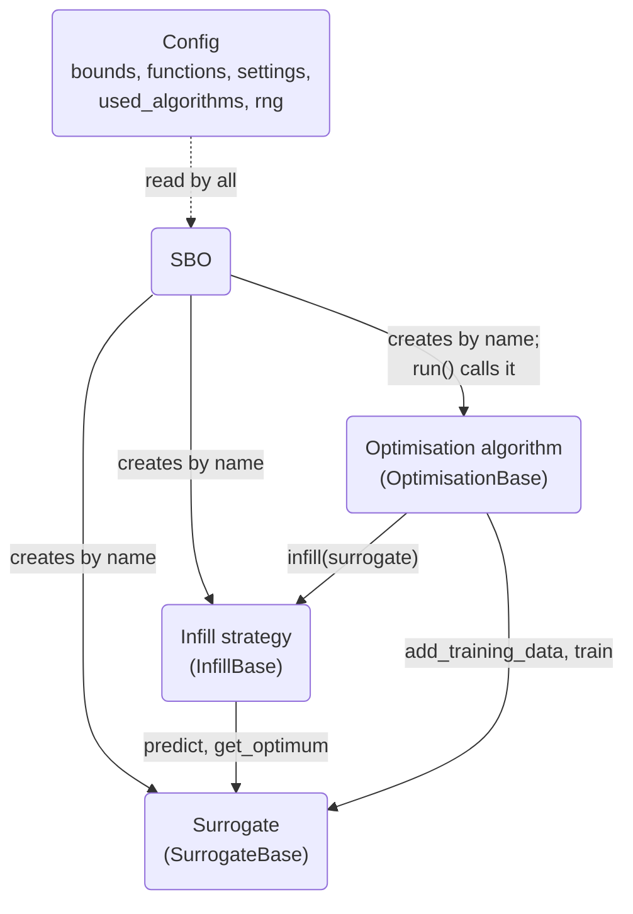
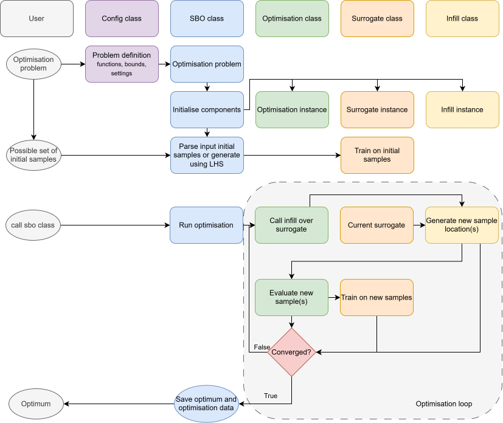
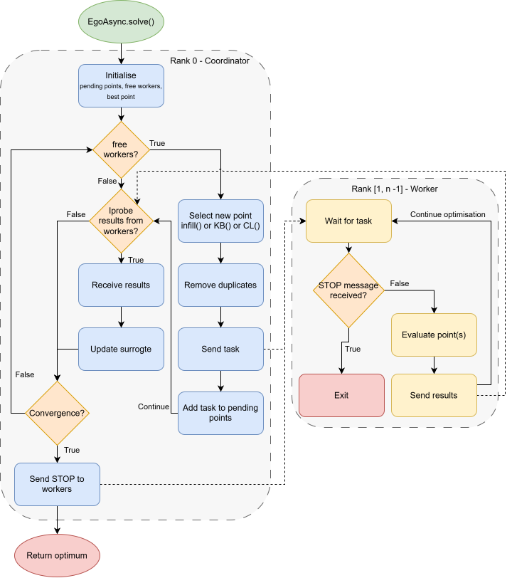

# Architecture

This page explains how the parts of the package work together. The classes themselves are documented in the
[API Reference](../api/sbo/SBO.md).

## Package Layout

| Path                             | Contents                                                                               |
| -------------------------------- | -------------------------------------------------------------------------------------- |
| `sbo/SBO.py`                     | `SBO`: creates the components, provides the initial samples, runs and plots.           |
| `sbo/utils/Config.py`            | `Config`: the problem definition and settings (singleton).                             |
| `sbo/utils/validate_settings.py` | Checks user settings against the default settings.                                     |
| `sbo/utils/Logger.py`            | `setup_logger` and `get_logger`.                                                       |
| `sbo/utils/Base.py`              | `Base`: stores the config; base class of every component.                              |
| `sbo/surrogate/`                 | Surrogate models, all derived from `SurrogateBase` (`surrogate/Base.py`).              |
| `sbo/infill/`                    | Infill strategies, all derived from `InfillBase` (`infill/Base.py`).                   |
| `sbo/optimisation/`              | Optimisation algorithms, all derived from `OptimisationBase` (`optimisation/Base.py`). |
| `sbo/DefaultSettings/`           | The default settings of every component, one `*_DEFAULT_SETTINGS` dict each.           |
| `sbo/constants/`                 | Constants, e.g. the infill strategies that support expensive constraints.              |

## Components



- **`SBO`** creates the three components from the names in `config.used_algorithms`. It imports `sbo.<type>.<Name>` and
    takes the class `<Name>` from it, so a component's file must have the same name as its class. It then provides the
    initial samples (Latin hypercube, or the samples passed by the user) to the surrogate, and `run()` calls the
    optimisation algorithm.
- **The optimisation algorithm** owns the loop. It asks the infill strategy for new points, evaluates them with the
    objective functions, adds them to the surrogate, and checks the stopping criteria.
- **The infill strategy** only reads the surrogate: it returns new points to evaluate and an infill value.
- **The surrogate** stores the samples per fidelity, trains on them (lazily, when a prediction is needed after new
    data), and predicts values and, depending on the base class, variances.
- **`Config`** is shared by all of them: every component derives from `utils.Base`, which stores `self.config`.

### Data Flow

The diagram below follows the data through a run. Each column is the user or one of the classes, so it shows which class
handles each step: the problem definition goes into `Config`, `SBO` creates the components and trains the surrogate on
the initial samples, and the optimisation algorithm then runs the loop until it converges and returns the optimum.

{ width="100%" }

*Data flow through `SBO`: from the problem definition to the optimum.*

### Conditional Components

Some components decide in `__new__` that another class fits better, and return an instance of that class instead. They
update `config.used_algorithms` accordingly, and `SBO` takes its copy of the used algorithms only after the components
are created, so it does not see this as a change:

| Class                | Condition                      | Returns         | Why changed                                                                                 |
| -------------------- | ------------------------------ | --------------- | ------------------------------------------------------------------------------------------- |
| `HK`                 | One fidelity                   | `KRG`           | Using a single-fidelity, results in `HK` reducing to `KRG`.                                 |
| `FilteredGEI`        | One fidelity                   | `GEI`           | Using the multi-fidelity `FilteredGEI` with one fidelity is equivalent to `GEI`.            |
| `EgoMPI`, `EgoAsync` | No MPI or fewer than two ranks | `EgoSequential` | Without MPI or fewer than two ranks, the MPI-based algorithms are equal to `EgoSequential`. |

If the user changes `config.used_algorithms` (or calls `sbo.update_used_algorithms`) after creating the `SBO`, the
changed components are recreated at the next `run()`. A new surrogate keeps the training data of the old one.

## The Optimisation Loop

`EgoSequential` runs the loop in its simplest form, as in the optimisation loop of the data flow diagram above. Each
iteration it asks the infill strategy for new tasks, removes duplicates, evaluates the points, adds them to the
surrogate and retrains it, and then stores the iteration data and checks the stopping criteria. After the loop it
evaluates the surrogate optimum on the HF function, and returns the best of the HF samples and that point.

The multi-point algorithms change who evaluates the points and when:

- **`EgoMPI`** proposes up to `number_new_points` tasks per iteration (the extra ones with Kriging Believer or Constant
    Liar), scatters them over all ranks, gathers the results, and then continues as above.
- **`EgoAsync`** runs the loop on rank 0 only. Ranks 1 to N-1 are workers: as soon as one is free it gets a new task,
    and every received result is added to the surrogate and stored as an "iteration" (keyed by a zero-padded counter).
    After a stopping criterion is met, rank 0 stops the workers, adds the results that still arrive, and then evaluates
    the surrogate optimum.

The diagram below shows the program flow of `EgoAsync.solve()`. The solid arrows are the flow within a rank, and the
dotted lines the MPI messages between the coordinator (rank 0) and the workers (ranks 1 to n-1): tasks, results and the
stop message.

{ width="100%" }

*Program flow of `EgoAsync`, with the MPI messages between the coordinator and the workers.*

The stopping criteria are described in [Settings and Stopping Criteria](../user/settings.md#stopping-criteria); the data
stored per iteration in [Results, Plots and Logs](../user/results.md#optimisation-data).

## Data Structures

These structures are used throughout the code:

| Name              | Shape                                                                                                                     | Used for                                                                                                            |
| ----------------- | ------------------------------------------------------------------------------------------------------------------------- | ------------------------------------------------------------------------------------------------------------------- |
| Point             | `{"coord": np.ndarray, "fid": int}`, plus `"value": float` once evaluated, and `"start_time"`, `"end_time"`, `"mpi_rank"` | A location to evaluate, or an evaluated sample. `fid` 0 is the HF function.                                         |
| Task              | `list[Point]`                                                                                                             | Points that are evaluated together by one worker, e.g. the same location at several fidelities for nested sampling. |
| Tasks             | `list[Task]`                                                                                                              | What an infill strategy returns (with the infill value): `tuple[list[list[dict]], float]`.                          |
| Samples           | `{fid: list[Point]}`                                                                                                      | `surrogate.samples`: the training data per fidelity.                                                                |
| Optimisation data | `{iteration: {...}, "init": ..., "total": ..., ...}`                                                                      | Everything stored during a run; see [Results](../user/results.md#optimisation-data).                                |

## Config

`Config` holds the problem definition and the settings, and is a singleton: `Config.get_instance()` returns it from
anywhere, and creating a new `Config` re-initialises the same instance.

- **Objective functions** are wrapped when the config is created, so they always return a 1D float array (users may
    return a plain float). Code reads the value as `config.functions[fid](x)[0]`.

- **Settings** are validated against the default settings of the general settings and of the three selected algorithms
    (`validate_settings`), and stored as a nested dict:

    ```python
    {
        "random_seed": 42,                       # general settings
        ...,
        "surrogate": {"corr": "squar_exp", ...},  # settings of the selected surrogate
        "infill": {...},                          # settings of the selected infill strategy
        "optimisation": {"max_iterations": 300, ...},
    }
    ```

- **Random numbers:** `config.rng` is a `np.random.Generator` seeded with `random_seed`; use it for every random choice
    in a component, so runs stay reproducible.

### Retrieving Settings

A general setting can be read in any of these ways:

```python
value = config.get("random_seed")
value = config.get_setting("random_seed")
value = config["random_seed"]
```

A setting of one of the algorithms:

```python
value = config.get("infill.g")
value = config.get_setting("g", algorithm="infill")
value = config["infill"]["g"]
value = config["infill.g"]
```

`config.get(key)` raises a `KeyError` for an unknown key; `config.get(key, default, strict=False)` returns the default
instead.
