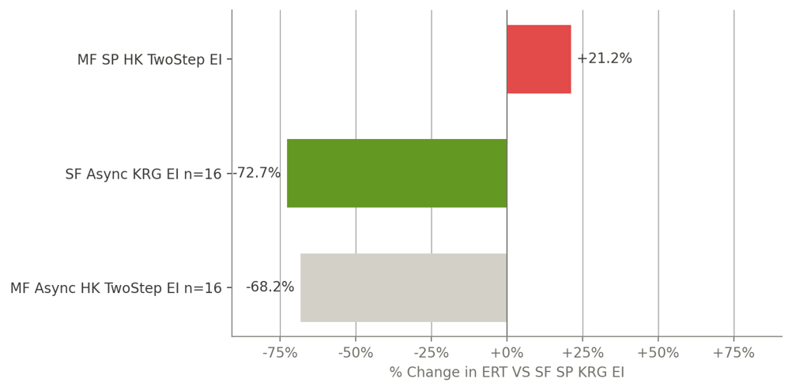

# Multi-fidelity Multi-point SBO

A framework for surrogate-based optimisation (SBO) with asynchronous multi-point and/or multi-fidelity infill
strategies, developed for the MSc thesis
[*Combining an Asynchronous Multi-Point and a Multi-Fidelity Infill Strategy for Surrogate-Based Optimisation*](https://resolver.tudelft.nl/uuid:baf55719-5cc1-42ae-b9f7-55af0f2292d8).

Version 1.0.0 is the code exactly as used for the thesis results. It is not actively developed: known limitations and
unfinished parts are listed under [Included Algorithms](#included-algorithms), and issues and pull requests may not get
a response.

The package implements Efficient Global Optimisation (EGO): a surrogate model is fitted to the samples evaluated so far,
an infill strategy uses the surrogate to choose where to sample next, and an optimisation algorithm drives this loop
until a stopping criterion is met. On top of standard single-point EGO it supports:

- **Multi-point infill:** several points are evaluated in parallel with MPI, either synchronously (`EgoMPI`) or
    asynchronously (`EgoAsync`), where a new point is proposed as soon as a worker is free.
- **Multi-fidelity optimisation:** cheaper, lower-fidelity version(s) of the objective are combined with the expensive
    high-fidelity function to reduce the number of expensive evaluations.
- **Verified implementations:** the main surrogates, infill strategies and optimisers are checked against reference
    implementations.
- **HPC:** an Apptainer container for running on a cluster with the host's MPI.

## Thesis Results

The thesis benchmarked the strategies on eleven two-fidelity test functions and compared them with sequential,
single-fidelity EGO (Kriging and Expected Improvement), using the expected runtime (ERT) to reach the optimum:

- **Asynchronous multi-point** (16 MPI processes: 1 coordinator and 15 workers): the ERT dropped by **72.7%**, a
    statistically significant improvement.
- **Multi-fidelity** (hierarchical Kriging with `TwoStep`, single-point): the ERT increased by 21.2%.
- **Both combined:** the ERT dropped by 68.2%, so the multi-fidelity part cost some of the multi-point gain.

The multi-fidelity strategy added redundant low-fidelity samples near the optimum, because `TwoStep` reselects the
sample location based on the residual variance of the hierarchical Kriging model. Tests with eleven different
low-fidelity versions of the Forrester function showed that this is structural, not caused by one particular
low-fidelity function. Adapting the fidelity-selection threshold during the optimisation, or using a different
multi-fidelity criterion, are the most promising ways to gain from combining both.



*Change in ERT relative to sequential, single-fidelity EGO with Kriging and EI (SF: single-fidelity, MF: multi-fidelity,
SP: single-point, Async: asynchronous multi-point, n: number of MPI processes).* The full results are in the
[thesis](https://resolver.tudelft.nl/uuid:baf55719-5cc1-42ae-b9f7-55af0f2292d8).

## Where to Start

- **[Getting Started](user/getting_started.md)**: install the package, run a first optimisation, and find the examples.
- **[User Guide](user/index.md)**: define a problem, change settings, use multiple fidelities or points, read the
    results.
- **[Developer Guide](dev/index.md)**: development environment, architecture, tests, and how to extend the framework.
- **[API Reference](api/sbo/SBO.md)**: generated from the source code, including the full
    [Settings Reference](api/settings_reference.md) and [Constants Reference](api/constants_reference.md).

## Included Algorithms

The algorithms are selected by name in the `used_algorithms` argument of `Config`.

=== "Surrogate models"

    | Name    | Description                                                | Fidelities | Status                |
    | ------- | ---------------------------------------------------------- | ---------- | --------------------- |
    | `RBF`   | Radial basis function model                                | 1          | Verified              |
    | `KRG`   | Kriging model                                              | 1          | Verified              |
    | `HK`    | Hierarchical Kriging from [[1]](#references)               | 2 or more  | Verified              |
    | `MFK`   | Multi-fidelity Kriging, a wrapper around the SMT MFK model | 2 or more  | Not verified          |
    | `CoKRG` | Co-Kriging                                                 | 2 or more  | Not implemented (yet) |

`HK` and `MFK` are multi-fidelity surrogates, which can be used with one or more fidelities. With one fidelity they
reduce to `KRG`, and the multi-fidelity infill strategies fall back to their single-fidelity equivalents. `CoKRG` is not
implemented yet, so the multi-fidelity infill strategies that requires it (`FilteredGEI`) is not functional.

=== "Infill strategies"

    | Name          | Description                             | Fidelities         | Status                         |
    | ------------- | --------------------------------------- | ------------------ | ------------------------------ |
    | `EI`          | Expected Improvement                    | Samples HF only    | Verified                       |
    | `GEI`         | Generalised Expected Improvement        | Samples HF only    | Verified                       |
    | `TwoStep`     | Two-step infill from [[2]](#references) | Chooses a fidelity | Verified                       |
    | `Random`      | Add a random point                      | Random fidelity    | Verified                       |
    | `FilteredGEI` | Filtered GEI from [[3]](#references)    | Chooses a fidelity | Not functional (needs `CoKRG`) |
    | `CEI`         | Constrained Expected Improvement        | Samples HF only    | Not implemented (yet)          |

=== "Optimisation algorithms"

    | Name            | Description                                                                      | Status   |
    | --------------- | -------------------------------------------------------------------------------- | -------- |
    | `EgoSequential` | Sequential single-point EGO                                                      | Verified |
    | `EgoMPI`        | Synchronous multi-point EGO, using MPI to evaluate candidate points in parallel  | Verified |
    | `EgoAsync`      | Asynchronous multi-point EGO, using MPI to evaluate candidate points in parallel | Verified |

    `EgoMPI` and `EgoAsync` need an MPI implementation and at least two MPI ranks. Without MPI, the optimisation falls back
    to `EgoSequential` with a warning in the log.

**Status:**

- **Verified:** the results were checked against a reference implementation or the paper (see the verification tests).
- **Not verified:** runs, but the results have not been checked.
- **Not functional / Not implemented:** creating it raises a `NotImplementedError`.

## References

1. Zhong Hua Han and Stefan Görtz. "Hierarchical kriging model for variable-fidelity surrogate modeling". *AIAA Journal*
    50.9 (2012), pp. 1885–1896. DOI: [10.2514/1.J051354](https://doi.org/10.2514/1.J051354).
2. A. Garbo, J. Parekh, T. Rischmann, and P. Bekemeyer. "Multi-Fidelity Adaptive Sampling for Surrogate-Based
    Optimization and Uncertainty Quantification". *Aerospace* 11.6 (2024), p. 448. DOI:
    [10.3390/aerospace11060448](https://doi.org/10.3390/aerospace11060448).
3. Z. Guo, Q. Wang, L. Song, and J. Li. "Parallel multi-fidelity expected improvement method for efficient global
    optimization". *Structural and Multidisciplinary Optimization* 64.3 (2021), pp. 1457–1468. DOI:
    [10.1007/s00158-021-02931-1](https://doi.org/10.1007/s00158-021-02931-1).

## Citation

If you use this code, please cite the thesis. On GitHub, the "Cite this repository" button gives the same citation in
APA and BibTeX (generated from `CITATION.cff`).

```bibtex
@mastersthesis{oostmeijer2026,
  author = {Oostmeijer, Ids},
  title  = {Combining an Asynchronous Multi-Point and a Multi-Fidelity Infill Strategy for Surrogate-Based Optimisation: An Empirical Evaluation on Unconstrained Problems},
  school = {Delft University of Technology},
  year   = {2026},
  month  = jul,
  url    = {https://resolver.tudelft.nl/uuid:baf55719-5cc1-42ae-b9f7-55af0f2292d8}
}
```

## Licence

MIT. The optional `benchmarks` extra (mf2) is licensed under the GPLv3.
