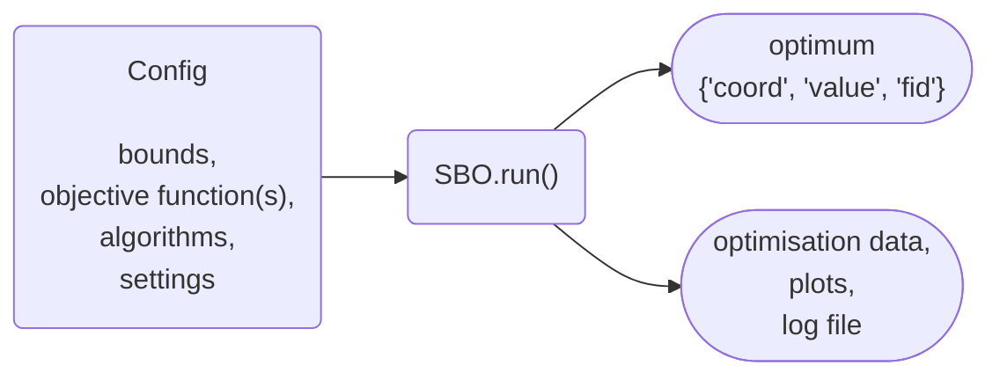

# User Guide

An optimisation needs two objects: a `Config`, which describes the problem, and an `SBO`, which runs the optimisation
loop on it and returns the best point found.

Inside `SBO.run()`, a surrogate model is fitted to the evaluated samples, an infill strategy uses it to choose the next
point(s), and the optimisation algorithm evaluates them and repeats this until a stopping criterion is met.

## Pages

| Page                                             | Read it to                                                                                  |
| ------------------------------------------------ | ------------------------------------------------------------------------------------------- |
| [Getting Started](getting_started.md)            | install the package, run a first optimisation, and find the example scripts                 |
| [Defining a Problem](configuration.md)           | write the objective function(s), set the bounds, choose the algorithms, add initial samples |
| [Settings and Stopping Criteria](settings.md)    | change settings, control when the optimisation stops, and make runs reproducible            |
| [Multi-fidelity Optimisation](multi_fidelity.md) | combine cheap low-fidelity functions with the expensive high-fidelity one                   |
| [Multi-point Optimisation](multi_point.md)       | evaluate several points in parallel with MPI                                                |
| [Results, Plots and Logs](results.md)            | read, save and plot the results, and find the log file                                      |
| [Running on HPC](hpc.md)                         | run on a cluster with the Apptainer container                                               |
| [Troubleshooting](troubleshooting.md)            | solve common problems                                                                       |

Every setting is listed with its description and default in the [Settings Reference](../api/settings_reference.md).
